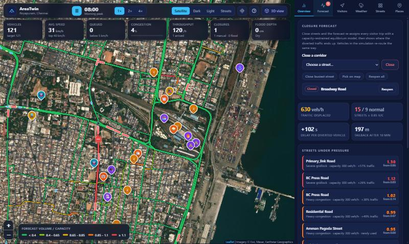
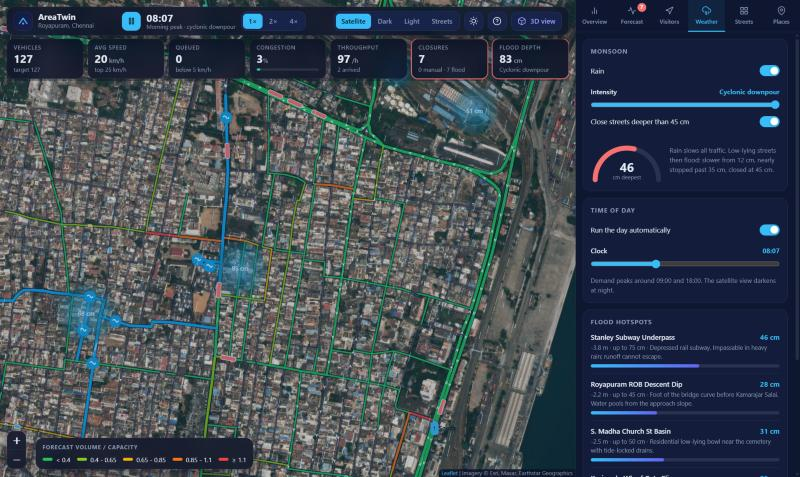

# AreaTwin · Royapuram Digital Twin

A live traffic digital twin of **Royapuram, Chennai**. Vehicles drive the real OpenStreetMap street network (848 streets, 143 km) with proper car-following physics, and you can close streets, send visitor waves to temples and stations, or let the monsoon flood the low basins to see what happens next.

It runs entirely in the browser. No build step and no API keys.



## What it does

| | |
| --- | --- |
| **Microscopic simulation** | Every car, two-wheeler, auto-rickshaw and bus follows a route over the directed street graph and is driven by the Intelligent Driver Model. Gaps, queues and stop-and-go waves emerge from the physics. One-way streets, narrow-street speed caps, dead-end U-turns and bus-only corridors are all respected. |
| **Closure forecast** | Close one or more streets and the app re-assigns every visitor trip with a capacity-restrained equilibrium model (BPR delay function + method of successive averages). It reports displaced traffic, the streets pushed into congestion, the delay per diverted vehicle, a tailback estimate and a suggested response. The simulated vehicles re-route around the closure at the same time. |
| **Visitor flows** | Send up to 4,000 visitors/hour from any of four entry gateways (or the local wards) to any of 29 places. The real shortest drivable route is drawn on the map. |
| **Monsoon and flooding** | Three rain intensities slow all traffic. Six surveyed low basins (Stanley Subway, Kasimedu slipway, ...) and 187 low-lying streets flood, slow traffic past 12 cm and close at 45 cm, which feeds back into the forecast. |
| **Time of day** | A two-peak demand curve (about 09:00 and 18:00) drives fleet size. The satellite view darkens at night. |
| **Six street colourings** | Road class, live simulated speed, forecast volume/capacity, diversion vs a normal day, flood depth and elevation. |
| **Inspectors** | Click a street, a vehicle (live speedometer, gap to the leader, route, follow-cam) or a place. |
| **Four base maps** | Satellite, dark, light and streets, plus a light/dark interface that works on phones as a bottom sheet. |



## Run it

```bash
git clone https://github.com/saaqibA21/areatwiin.git
cd areatwiin
python serve.py
```

Open <http://localhost:8000/>. Any static file server works (`python -m http.server`), but `serve.py` also sends no-cache headers so edits show up on reload. The data is loaded with `fetch`, so opening `index.html` straight from disk will not work.

The base maps need an internet connection (Leaflet and tiles load from public CDNs).

| Page | What it is |
| --- | --- |
| `index.html` | The main app described above (Leaflet) |
| `3d.html` | The original Three.js 3D streetscape, with a runtime error fixed |
| `google_maps_twin.html` | The older Google Maps edition. It needs your own key: open it as `google_maps_twin.html?key=YOUR_KEY` |

### Keyboard shortcuts

`Space` play/pause · `1` `2` `4` speed · `R` rain · `C` pick streets to close · `T` cycle street colouring · `/` search places · `Esc` clear selection · `?` help

## How it works

```
js/network.js   loads data, splits streets at T-junctions, builds the directed edge graph
js/router.js    binary-heap Dijkstra
js/sim.js       IDM car-following, routing, closures, re-routing, live statistics
js/forecast.js  calibrated traffic assignment and baseline-vs-scenario comparison
js/weather.js   rain, flood depth, speed penalties and automatic closures
js/mapview.js   Leaflet map, street styling, canvas layers for vehicles, flood and rain
js/charts.js    small canvas charts
js/main.js      UI wiring and the animation loop
```

Things worth knowing:

- **Junctions are rebuilt from geometry.** The source adjacency lists are asymmetric and link some street ends hundreds of metres apart, so the graph is rebuilt: through streets are split where another street ends against their side (848 streets become 1,685 segments), and streets connect only where their ends actually touch (30 m at most). 98.8% of directed edges end up in one strongly connected component.
- **Traffic volumes are model estimates, not counts.** The forecast is calibrated so the busiest arterial runs at 0.85 volume/capacity on a normal day. Treat results as relative, for comparing scenarios.
- **Demand** comes from the typical visitor numbers in `data/pois.json`, at 0.5 vehicles per visitor, split across the gateways.

### Tests

```bash
node tests/logic.test.mjs
```

Checks the graph (no teleporting links, every gateway reaches every place), the forecast (closing a street cannot reduce total travel time), and the simulation (no overlapping vehicles, vehicles actually arrive, closures are respected).

## Data

`data/roads.json` and `data/pois.json` are derived from OpenStreetMap (© OpenStreetMap contributors, ODbL). The raw downloads and the scripts that produced them are in `data/raw/` and `scripts/` for provenance; see `scripts/README.md`.

## Security note

An earlier version of this repository shipped a Google Maps API key in its source. It has been removed from the current files, but it remains in the git history, so **revoke or restrict that key** in the Google Cloud console.

## License

MIT
